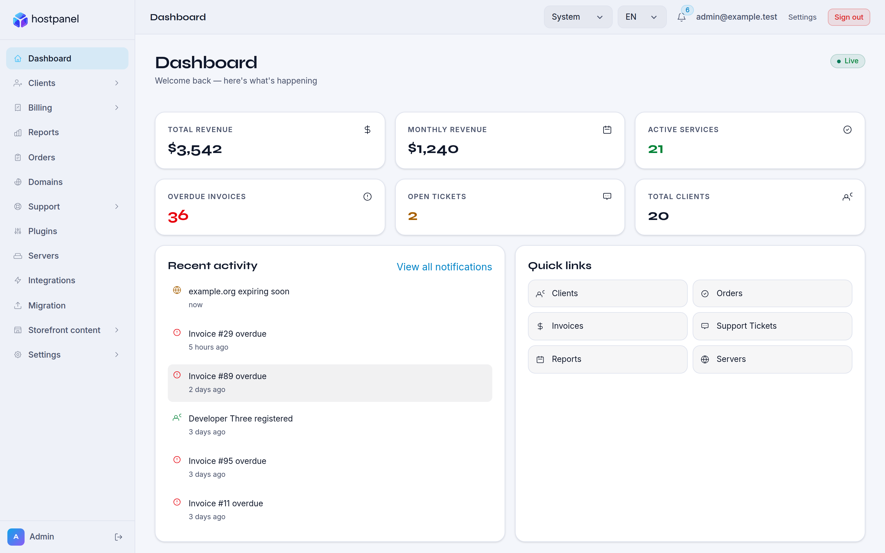
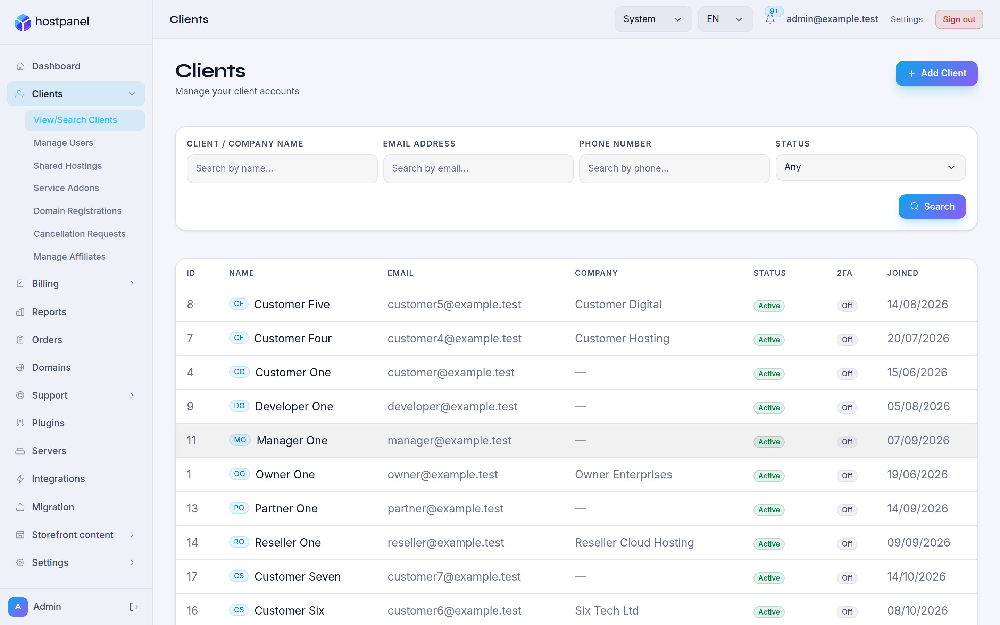
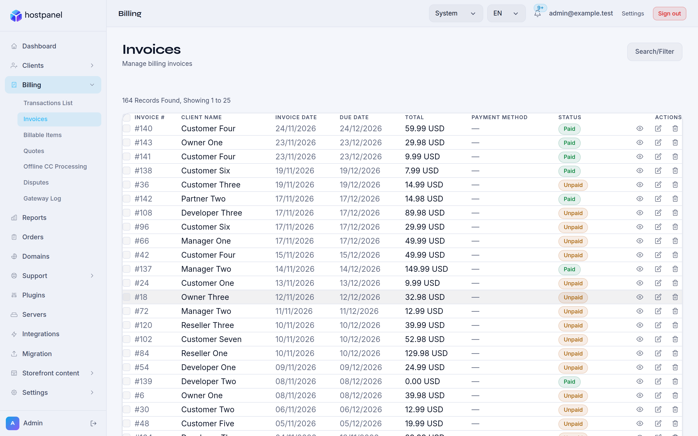
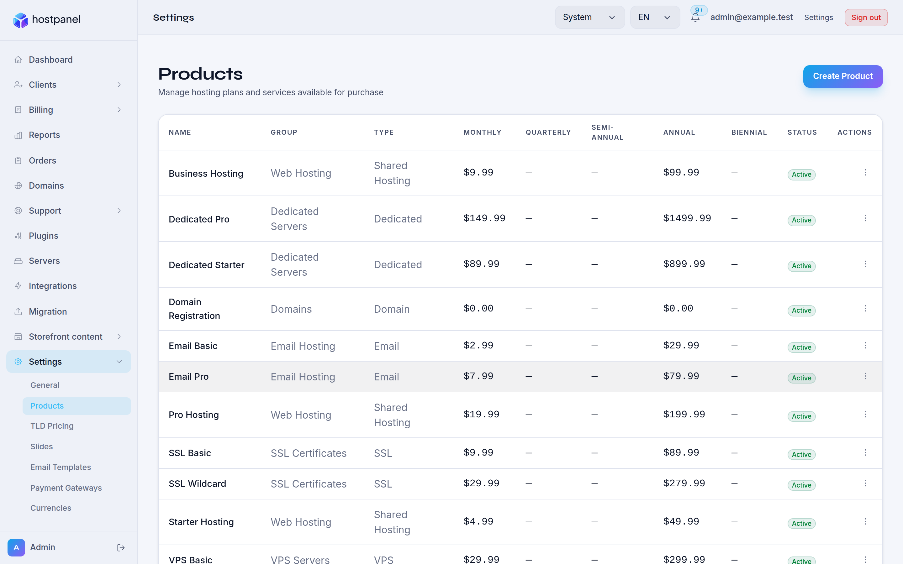
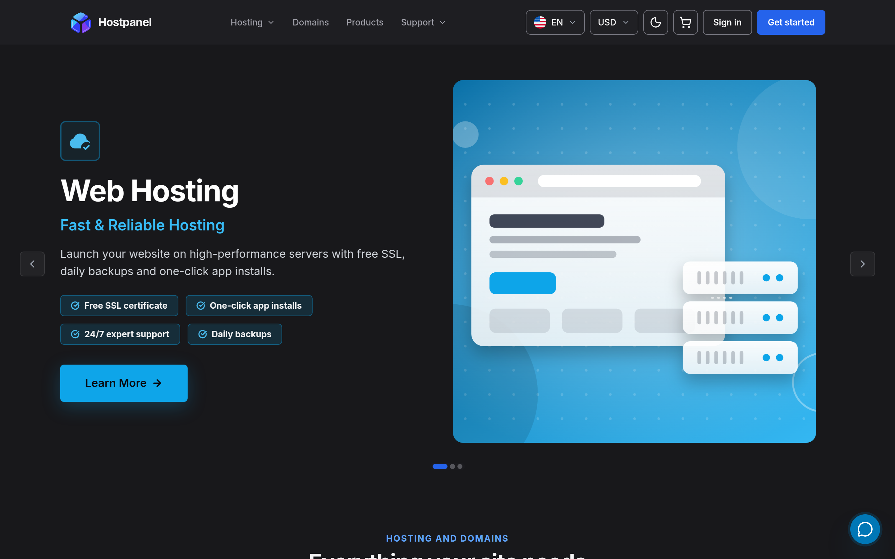
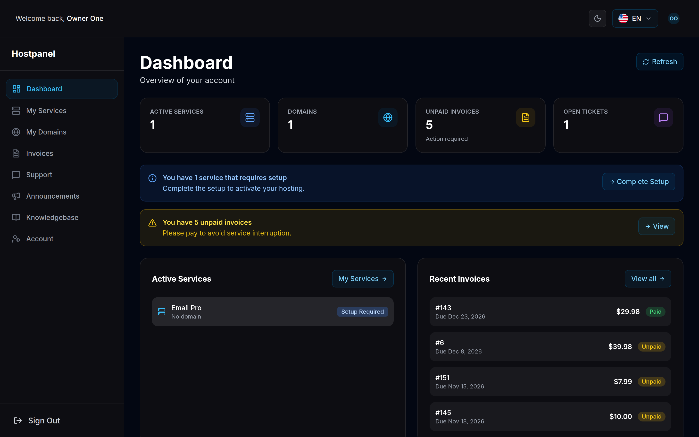

<p align="center">
  <picture>
    <source media="(prefers-color-scheme: dark)" srcset="logo-dark.svg">
    <source media="(prefers-color-scheme: light)" srcset="logo.svg">
    
  </picture>
</p>

<h1 align="center">HostPanel</h1>

<p align="center">
  <b>Self-hosted billing, domains and provisioning for web hosting companies.</b><br>
  Client portal, admin panel and API in one open-source stack. Install it with one command.
</p>

<p align="center">
  <a href="LICENSE"></a>
  <a href="https://hub.docker.com/r/innovayse/hostpanel"></a>
  <a href="https://github.com/innovayse/hostpanel/actions/workflows/ci.yml"></a>
  <a href="https://discord.gg/NfqTkyTgD"></a>
</p>

<p align="center">
  <b>Try the demo:</b>
  <a href="https://demo-hostpanel.innovayse.com">client portal</a> ·
  <a href="https://demo-hostpanel-admin.innovayse.com">admin panel</a><br>
  <sub>Sample data, reset regularly. The demo sign-in details are on each login page.</sub>
</p>

---

## Why HostPanel

If you sell hosting or domains you need a client portal, invoicing, a domain registrar link and
automatic account creation on your servers. HostPanel does that job with code you can read, run on
your own machine and extend.

- **You own it.** AGPL-3.0, self-hosted with Docker, no per-client licence fee.
- **Modern stack.** ASP.NET Core 9 and PostgreSQL behind a Nuxt 4 storefront and a Vue 3 admin panel.
- **Built to be extended.** Payment gateways, registrars and control panels sit behind small
  interfaces. You can add your own with the plugin SDK, without changing the core.
- **Ready in minutes.** Prebuilt multi-arch images (`amd64`, `arm64`) on Docker Hub and an installer
  that sets up HTTPS for you.

## Screenshots

| Admin dashboard | Clients |
|---|---|
|  |  |
| **Invoices** | **Products** |
|  |  |
| **Client portal** | **Client area** |
|  |  |

Taken from the local development stack with its seeded sample data.

## Features

| Area | What you get |
|---|---|
| Billing and invoices | Invoices, transactions, credits, quotes, billable items, promotions, aging and income reports |
| Multi-currency | Several currencies with rates, resolved per client |
| Domains and TLD pricing | Domain search and registration through registrar plugins, per-TLD pricing, renewals and renewal e-mails |
| Hosting provisioning | Products and services, orders, automatic account creation, suspension and termination on your servers |
| Support tickets | Client tickets, predefined replies, announcements, network issues |
| Knowledge base | Public articles for the storefront, managed from the admin panel |
| Storefront content | Testimonials, partners, projects and FAQs in English, Russian and Armenian, managed from the admin panel; empty sections are hidden |
| Client portal | Order, pay invoices, manage services and domains, open tickets; three switchable storefront designs, brandable without code |
| Admin panel | Clients, orders, products, gateways, integrations, e-mail templates, plugins, reports, audit log |
| Demo mode | Fake payments, registrar and provisioning, caught mail, fixed sample data reset on a schedule, on a network isolated from production |
| Languages | English, Russian and Armenian in both the portal and the admin panel |
| Plugin SDK | `Innovayse.SDK` (MIT, a NuGet package, developed in [hostpanel-sdk](https://github.com/innovayse/hostpanel-sdk)) for your own payment, registrar, provisioning, identity, fulfilment and hosted plugins |
| Integrations | Payments: Stripe (cards, saved cards), Inecobank (as a plugin), bank transfer. Registrars: Namecheap, Name.am. Control panels: CWP7, Plesk. Notifications: Telegram |
| Data import from WHMCS | A PHP addon you install in WHMCS. HostPanel pulls clients, contacts, products, orders, services, domains, invoices, transactions, quotes, tickets, announcements, knowledge base, downloads and network issues from it, page by page. See [Moving from another billing system](docs/migration/from-another-system.md) |

See the [open feature requests](https://github.com/innovayse/hostpanel/issues?q=is%3Aissue+is%3Aopen+label%3Aenhancement)
for what is coming next.

## HostPanel vs WHMCS

This table compares what HostPanel and WHMCS offer today. WHMCS facts come from its own [pricing page](https://www.whmcs.com/pricing/), its
[documentation](https://docs.whmcs.com/9-0/tags/php) and the
[module list](https://docs.webpros.cloud/docs/whmcs-cloud/included-modules/) of its publisher, WebPros.

| | HostPanel | WHMCS |
|---|---|---|
| License | AGPL-3.0, full source on GitHub | Commercial licence. Its PHP files are encoded and need the ionCube Loader |
| Cost | No licence fee | Monthly plans, priced by the number of active clients |
| Where it runs | Self-hosted, with Docker | Self-hosted, or WHMCS Cloud run by the vendor |
| Control panels | CWP7, Plesk | cPanel, Plesk, DirectAdmin and others |
| Domain registrars | Namecheap, Name.am | Many, including Namecheap, OpenSRS and Nominet |
| Payment gateways | Stripe, Inecobank, bank transfer | Many, including Authorize.net, BitPay and bank transfer |
| Extensions | A plugin SDK (MIT). Few plugins exist so far | A large marketplace of third-party modules |
| Moving over | An importer that pulls your data out of WHMCS | Not applicable |

### What HostPanel does not have yet

- cPanel and DirectAdmin provisioning.
- PayPal and other payment gateways beyond the three above.
- Registrars other than Namecheap and Name.am, such as ResellerClub or OpenSRS.
- Automatic tax calculation. Staff set a tax rate on each invoice by hand.
- Automatic fraud checks on new orders. Staff can mark an order as fraud by hand.
- A hosted option. You run HostPanel on your own server.
- A marketplace of ready-made modules.

## Quick start with Docker

On a Linux server with [Docker](https://docs.docker.com/get-docker/) and Compose v2, point the DNS of your
domain and admin domain at the server, keep ports 80 and 443 open, and run one command:

```bash
curl -fsSL https://raw.githubusercontent.com/innovayse/hostpanel/main/install.sh | bash
```

The script downloads only `docker-compose.hub.yml`, `Caddyfile` and `.env.example` into `/opt/hostpanel`, then:

1. asks for your domain, the admin domain and an admin e-mail (also the certificate contact);
2. generates every secret with `openssl` and writes `.env`;
3. pulls the images from Docker Hub and starts the stack;
4. waits for the API and prints the URLs plus the one-time **setup token**.

**HTTPS is automatic.** The bundled [Caddy](https://caddyserver.com) edge obtains and renews Let's Encrypt
certificates for both hosts.

| Setting | Flag | Environment variable |
|---|---|---|
| Install directory (default `/opt/hostpanel`) | `--dir` | `HOSTPANEL_DIR` |
| Release to install (default `latest`) | `--version` | `HOSTPANEL_VERSION` |
| Plain HTTP on port 8080 behind your own TLS proxy | `--no-tls` | `HOSTPANEL_TLS=off` |
| Non-interactive answers | | `HOSTPANEL_DOMAIN`, `HOSTPANEL_ADMIN_DOMAIN`, `HOSTPANEL_ADMIN_EMAIL` |

Pass a flag through the pipe with `... | bash -s -- --version 1.4.0 --no-tls`. For a run without questions set the
three answer variables (`HOSTPANEL_NONINTERACTIVE=1` forces it even with a terminal).

**First admin account.** On a fresh install the API prints a one-time setup token to its log:

```bash
cd /opt/hostpanel && docker compose -f docker-compose.hub.yml logs hostpanel-api | grep "setup token"
```

Open the admin panel, create your account and paste the token when asked. It proves you operate the server and stops
working once setup is done.

## Using the Docker Hub images

Everything is published to **one repository, [`innovayse/hostpanel`](https://hub.docker.com/r/innovayse/hostpanel)**.
The component is part of the tag:

| Component | Pinned to a release | Moving |
|---|---|---|
| API | `innovayse/hostpanel:api-<version>` | `innovayse/hostpanel:api-latest` |
| Client portal | `innovayse/hostpanel:client-<version>` | `innovayse/hostpanel:client-latest` |
| Admin panel | `innovayse/hostpanel:admin-<version>` | `innovayse/hostpanel:admin-latest` |

`<version>` has no leading `v` (`1.2.3`). In `.env`, `IMAGE_TAG` is that version or `latest`; the compose file adds the
component prefix. The images are built with `AUTH_MODE=local`.

### Minimal manual run

You need `docker-compose.hub.yml`, `docker/caddy/Caddyfile` (copy it next to the compose file) and a `.env`:

```bash
cd docker
cp .env.example .env     # set DOCKERHUB_NAMESPACE=innovayse, IMAGE_TAG, ASPNETCORE_ENVIRONMENT=Production, ACME_EMAIL and the secrets
docker compose -f docker-compose.hub.yml up -d
```

The file is standalone (it replaces `shared` + `prod`) and refuses to start without `DOCKERHUB_NAMESPACE`, `IMAGE_TAG`,
`POSTGRES_PASSWORD`, `RABBITMQ_PASSWORD`, `JWT_SECRET`, `ENCRYPTION_KEY` and `ALLOWED_HOSTS`. The admin panel is built for
the root path, so serve it on its own host. Use `EDGE_SCHEME=http://` for plain HTTP behind your own proxy.

### Operating it

| Task | How |
|---|---|
| Upgrade | Re-run the install script (an existing `.env` is kept; with `--version` it moves `IMAGE_TAG`), or `docker compose -f docker-compose.hub.yml pull && docker compose -f docker-compose.hub.yml up -d` |
| Pin a version | Set `IMAGE_TAG=1.4.0` in `.env` instead of `latest` |
| Logs | `docker compose -f docker-compose.hub.yml logs -f hostpanel-api` (or `hostpanel-client`, `hostpanel-admin`) |
| Back up the database | `docker compose -f docker-compose.hub.yml exec -T hostpanel-db sh -c 'pg_dump -U "$POSTGRES_USER" "$POSTGRES_DB"' > backup.sql`, or snapshot the `hostpanel_pgdata` volume |
| Keep certificates | Do not delete the `hostpanel_caddydata` volume; re-issuing can hit Let's Encrypt rate limits |

## Demo mode

Run a self-contained demo (fake payments, registrar and provisioning, mail caught by a test inbox, data reset on a
schedule) next to anything else on the machine. Fill the `# Demo` block of `docker/.env` (from `docker/.env.example`,
with `AUTH_MODE=local`), then:

```bash
docker compose -p hostpanel-demo -f docker/docker-compose.shared.yml -f docker/docker-compose.prod.yml -f docker/docker-compose.demo.yml up --build
```

The API runs with `Demo__Enabled`: the adapters are fakes, outgoing mail goes to the demo inbox, and the database is
re-seeded every `DEMO_RESET_INTERVAL_HOURS` hours with the accounts from `DEMO_ADMIN_*` and `DEMO_CLIENT_*`. The seed is
fixed and deterministic: the same sample data on every reset, rich enough to show every feature, and the site name is
`Hostpanel Demo`. It uses its own `hostpanel-demo-*` containers, volumes and a private network, and its three public-facing services sit on the dedicated external network `hostpanel_demo_edge` (create it once: `docker network create --subnet 172.29.0.0/16 hostpanel_demo_edge`), never the production network, so it cannot reach a
production stack on the same host. See [docker/README.md](docker/README.md). A public instance is running: the
[client portal](https://demo-hostpanel.innovayse.com) and the [admin panel](https://demo-hostpanel-admin.innovayse.com).

## Storefront content

Testimonials, partners, projects and FAQs are rows in the database, not files in the code. Manage them in the admin
panel under **Storefront content**, each with English, Russian and Armenian translations. The public site reads them from
`/api/public/testimonials`, `/api/public/partners`, `/api/public/projects` and `/api/public/faqs`, and hides any section
that has no entries.

The rest of the storefront text is settings: the hero stats and badge come from `portal.stats.*` and `portal.hero.badge`,
the contact channels from `portal.contact.*`, and the site name from `portal.site.name`. A production install receives the
previous static content once, through a one-time import; the demo does not run it and keeps its own fixed seed.

## Configuration

Copy `docker/.env.example` to `docker/.env`; the file documents every variable. The ones you touch first:

| Variable | Description |
|---|---|
| `AUTH_MODE` | `local` (standalone, email and password, optional TOTP) or `sso` (single sign-on through an external identity provider, needs an optional private package) |
| `DOMAIN` / `ADMIN_DOMAIN` | Public hosts of the portal and the admin panel |
| `ASPNETCORE_ENVIRONMENT` | `Production` for a real install: no demo data, no seeded accounts |
| `JWT_SECRET` | JWT signing key, at least 32 characters |
| `ENCRYPTION_KEY` | Encrypts stored server passwords and API tokens (`openssl rand -base64 32`) |
| `POSTGRES_PASSWORD`, `RABBITMQ_PASSWORD` | Database and broker passwords |
| `SMTP_HOST`, `SMTP_PORT`, `SMTP_ENCRYPTION`, `SMTP_FROM` | Outgoing mail; `SMTP_ENCRYPTION` is `tls`, `ssl` or `none` and is never guessed from the port |
| `IMAGE_TAG`, `DOCKERHUB_NAMESPACE` | Which published images `docker-compose.hub.yml` runs |
| `NUXT_PUBLIC_PORTAL_*` | Storefront template, name, logo and colours (the name falls back to `Hostpanel`; no operator brand is built in), see [docs/operators/storefront.md](docs/operators/storefront.md) |

## Run from source

You need Docker with Compose v2 and nothing else.

> This is a **development stack**: the API runs under `dotnet watch` with your source mounted and seeds demo data.
> Do not expose it to the internet.

```bash
git clone --recurse-submodules https://github.com/innovayse/hostpanel.git
cd hostpanel/docker
cp .env.example .env      # AUTH_MODE=local and ASPNETCORE_ENVIRONMENT=Development by default
docker compose -f docker-compose.shared.yml -f docker-compose.dev.yml up -d
docker compose -f docker-compose.shared.yml -f docker-compose.dev.yml logs -f hostpanel-api   # migrations and seeding run on startup
```

The plugin SDK in `backend/src/Innovayse.SDK` is a git submodule from its own repository,
[innovayse/hostpanel-sdk](https://github.com/innovayse/hostpanel-sdk). After a plain `git clone`, and after every pull
that moves it, run `git submodule update --init` from the repository root; without it the backend has no SDK to build.

| | URL |
|---|---|
| Client portal | http://localhost:3001 |
| Admin panel | http://localhost:5174 |
| API docs (Swagger) | http://localhost:5149/swagger |
| Dev mail inbox | http://localhost:8027 |

In Development the API seeds an admin `admin@example.test` / `Admin123!` and sample clients such as `customer@example.test`.
Every compose stack (shared, dev, prod, platform, demo, hub) is described in [docker/README.md](docker/README.md).

**Without Docker** you need the .NET 9 SDK, Node.js 22+, yarn and PostgreSQL 17:

```bash
cd backend && dotnet run --project src/Innovayse.Hostpanel.API   # http://localhost:5148
cd client  && yarn install && yarn dev                            # http://localhost:3000
cd admin   && npm install && npm run dev                          # http://localhost:5173
```

Set the API's connection string, RabbitMQ and SMTP settings through environment variables, user-secrets or the
git-ignored `appsettings.Development.json`.

**Tests.** `dotnet test` in `backend/` runs the unit, architecture and integration suites (the integration suite starts
its own PostgreSQL through Testcontainers, so Docker must be running). Run `yarn test` / `yarn lint` in `client/` and
`npm run test` / `npm run lint` in `admin/`.

## Architecture in brief

| Part | Technology | Notes |
|---|---|---|
| Backend `backend/` | ASP.NET Core 9, Wolverine, EF Core, PostgreSQL | Clean Architecture: `Domain` (entities, rules) <- `Application` (CQRS handlers, validators) <- `Infrastructure` (EF Core, integrations) <- `API` (thin controllers) |
| Messaging | RabbitMQ with the Wolverine outbox | Reliable events between modules |
| Client portal `client/` | Nuxt 4, Vue 3, TypeScript, Tailwind, Pinia | Server-rendered storefront; pages own data and SEO, `templates/` hold the switchable designs |
| Admin panel `admin/` | Vite, Vue 3, TypeScript, Tailwind | Single-page app served by nginx |
| Plugins | `Innovayse.SDK` and `Innovayse.Providers.*` | Six plugin types behind small interfaces, loaded at run time: payment, registrar and provisioning providers, plus fulfilment (`IFulfilmentPlugin`: deliver digital products after payment, advise on refunds), identity (`IClientResolver`: decide which client a signed-in user acts for) and hosted (`IHostedPlugin`: a background worker). The integrations listed under Features are built into the core; today only Inecobank ships as a run-time plugin. The core names no deployment-specific plugin namespace; an architecture test enforces it |
| Auth | ASP.NET Core Identity, JWT in an httpOnly cookie | `local` mode by default |

Each app owns its Dockerfile (`backend/Dockerfile`, `client/Dockerfile`, `admin/Dockerfile`). A new payment gateway, registrar
or control-panel integration is one of the most useful contributions: open an issue first so we can agree on the shape.

### Writing a plugin

Start with [docs/developers/write-a-plugin.md](docs/developers/write-a-plugin.md). In short:

- **Manifest v2.** `plugin.json` with `"manifestVersion": 2` declares typed `settings`, `capabilities`, `locales`, an `api`
  block (the HTTP routes the plugin answers), a `ui` block (menus, pages and slot widgets) and `externalOrigins`.
- **Views.** A page or slot widget points at a JSON view document, `{ "schema": 1, "blocks": [...] }`, made of the block kinds
  `header`, `text`, `stat`, `table`, `form`, `action`, `link`, `badge`, `empty`, `alert`, `tabs`, `chat` and `progress`. The
  panels render it as text, never as HTML, in the visitor's language.
- **Slots.** Widgets go into `client.dashboard.cards`, `client.service.tabs`, `admin.client.panels` or `admin.service.panels`.
- **Endpoints.** The panels call a plugin only through the routes its `api` block declares, at
  `/api/client/plugins/{id}/...` and `/api/admin/plugins/{id}/ext/...`. Anything undeclared, disabled or not permitted for the
  caller answers the same 404.
- **Trust.** An uploaded package must carry a `plugin.sig` signature from a trusted key. An operator can switch on
  **Allow unsigned plugins** (off by default, audited) or pin archive digests with `Plugins:TrustedPackageSha256`. With no
  plugin installed the panels look exactly as the core ships them.

## Contributing, security, license

- **Contributing:** start with [good first issues](https://github.com/innovayse/hostpanel/issues?q=is%3Aissue+is%3Aopen+label%3A%22good+first+issue%22),
  read [CONTRIBUTING.md](CONTRIBUTING.md) and the [Code of Conduct](CODE_OF_CONDUCT.md). Questions go to
  [Discussions](https://github.com/innovayse/hostpanel/discussions).
- **Community:** chat and ask questions on [Discord](https://discord.gg/NfqTkyTgD).
- **Changes and help:** see the [CHANGELOG](CHANGELOG.md) for release notes and [SUPPORT.md](SUPPORT.md) for where to get help.
- **Security:** report problems privately as described in [SECURITY.md](SECURITY.md), not in a public issue.
- **License:** Copyright (c) 2024-2026 Innovayse LLC. Free software under the
  [GNU Affero General Public License v3.0 or later](LICENSE): use, modify and self-host it, including commercially. If you
  run a modified version as a network service, offer your users its source.
- **Plugin SDK license:** the plugin SDK (`backend/src/Innovayse.SDK`, a git submodule of its own repository
  [innovayse/hostpanel-sdk](https://github.com/innovayse/hostpanel-sdk), where it is developed and published) is under the
  [MIT License](https://github.com/innovayse/hostpanel-sdk/blob/main/LICENSE) and ships as the `Innovayse.SDK` NuGet package,
  so a plugin may be free or paid, open or closed source, as its author decides. Everything else in this repository stays
  AGPL-3.0-or-later.
